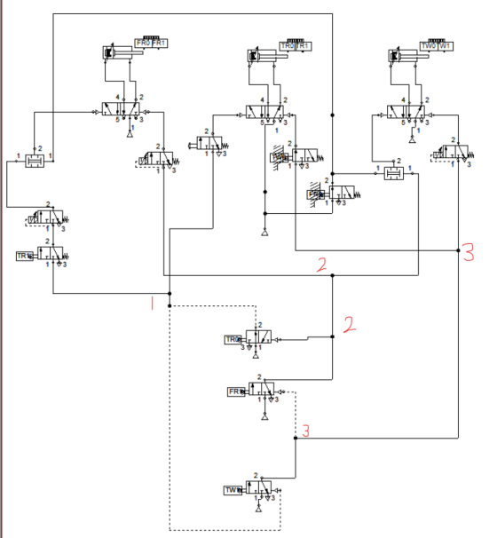

# Pneumatic Sequence Automation

Two **FluidSIM pneumatic automation designs** for sequential cylinder control: a timed wood-processing cycle and a ferrous-part transfer cycle. The project uses cascade groups, directional valves, end-position signals, and pneumatic timing to coordinate actuator motion.

## Circuits

| Design | Main sequence | Files |
| --- | --- | --- |
| Wood processing | Clamp, wait 1 s, machine for 5 s, retract, drill for 5 s, retract, release | [Circuit](circuits/01_wood_processing.ct), [explanation](projects/01_wood_processing.md) |
| Ferrous-part transfer | Hold a box, lower/raise a pickup cylinder, move across, deposit, return, and guide the transferred parts | [Circuit](circuits/02_ferrous_part_transfer.ct), [explanation](projects/02_ferrous_part_transfer.md) |

The supplied report separates the first circuit into three cascade groups and the second into four. The `.ct` files are preserved with descriptive filenames; their correspondence follows the supplied file numbering and report order and has not been confirmed by opening them in FluidSIM.

## Video demonstrations

This section is ready for the circuit films. **No films have been uploaded yet.**

| Film | Status |
| --- | --- |
| Wood-processing circuit: complete timed cycle | Awaiting upload |
| Ferrous-part transfer: complete actuator sequence | Awaiting upload |

See the [video folder and upload guide](videos/README.md). Each slot also has an entry in [videos/catalog.json](videos/catalog.json) for its future filename or URL.

## Explore the project

1. Read the [pneumatic report](reports/pneumatic_report.pdf), which contains the original technical pages in Persian.
2. Open a `.ct` circuit in a compatible FluidSIM installation. The original application version was not supplied.
3. Compare the cylinder labels, initial states, cascade-group transitions, and timer settings with the report.
4. Run the simulation and record a complete cycle for the matching video slot.

The report's introductory cylinder numbering differs from its detailed first-circuit explanation. Whiteboard notes also contain revisions. Those references are retained, with the differences explained in the project notes. Simulation and physical operation were not rerun during repository preparation.

## Files and references

- [Wood-processing notes](projects/01_wood_processing.md)
- [Ferrous-part transfer notes](projects/02_ferrous_part_transfer.md)
- [FluidSIM setup and source limitations](docs/RUNNING.md)
- [Wood sequence whiteboard](assets/wood_sequence_whiteboard.jpg)
- [Transfer sequence whiteboard](assets/transfer_sequence_whiteboard.jpg)
- [Credits](CREDITS.md) and [verification](docs/VERIFICATION.md)

The unrelated PLC section of the supplied combined report is organized in a separate repository. The additional `Industrial_Control(1).pdf` attachment was unavailable and was not used.
